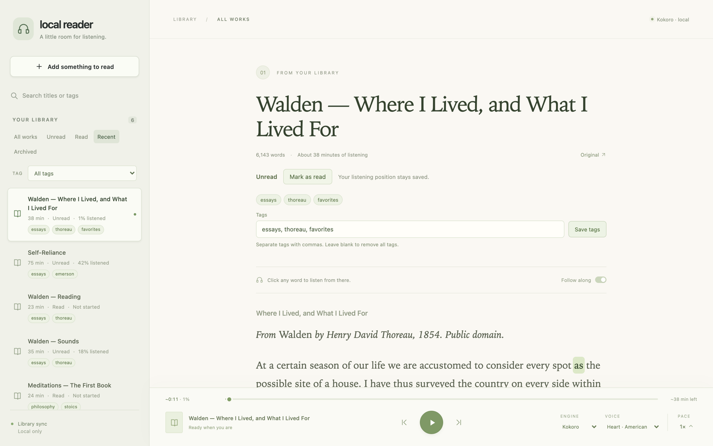
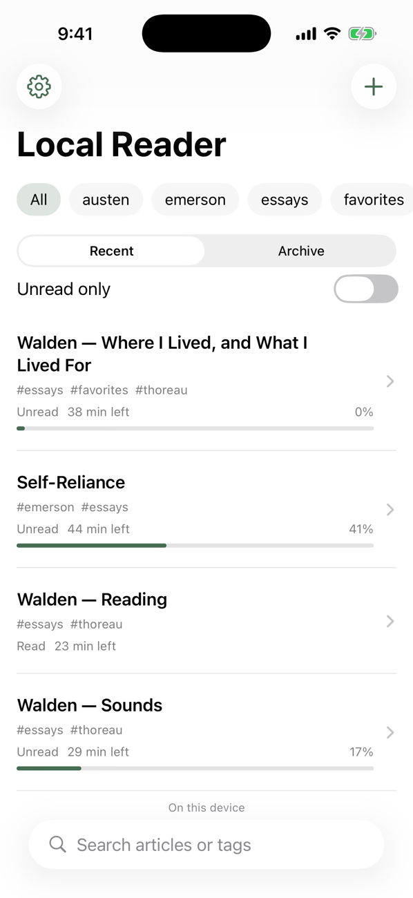
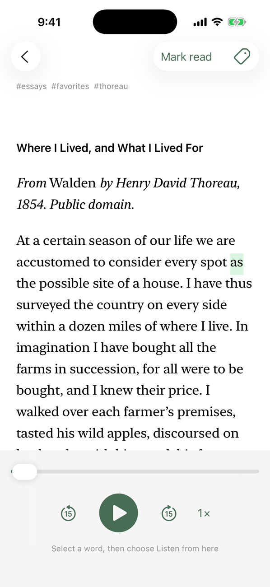
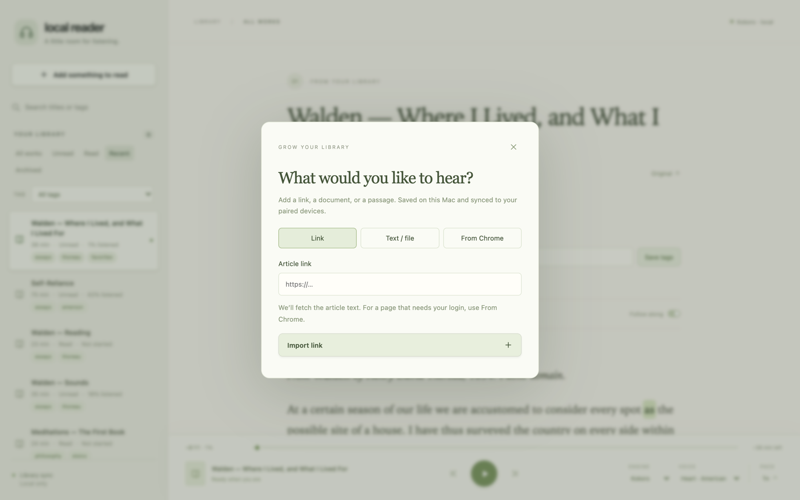
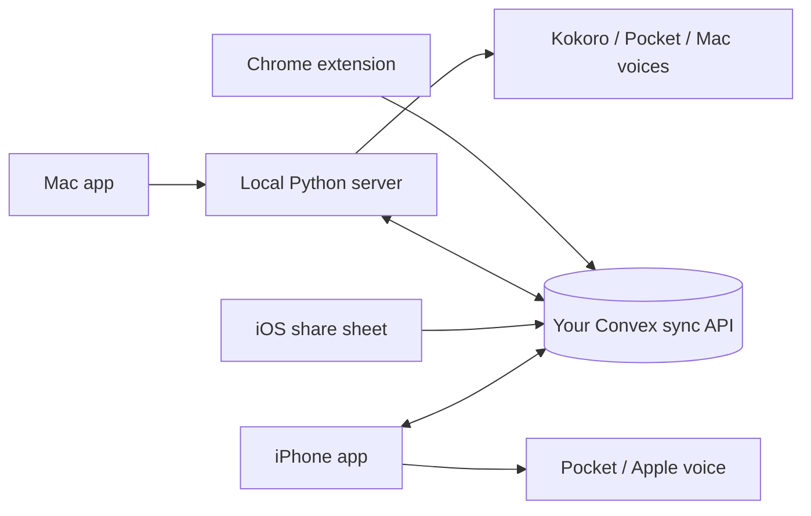

<p align="center">
  
</p>

<h1 align="center">Local Reader</h1>

<p align="center">
  A personal reading library that reads to you with on-device neural speech.<br>
  Mac and iPhone. No cloud speech API, no subscription.
</p>

<p align="center">
  <a href="https://github.com/ethanniser/local-reader/actions/workflows/ci.yml"></a>
  <a href="LICENSE"></a>
</p>



Save articles, essays, and documents, then listen to them with natural-sounding speech generated on your own device. The reader highlights each word as it is spoken. Click any word to start listening from there, and your place is saved across devices.

## Features

- **Local neural speech.** [Kokoro](https://huggingface.co/hexgrad/Kokoro-82M) runs on the Mac GPU through MLX. [Pocket TTS](https://github.com/kyutai-labs/pocket-tts) runs on the Mac CPU and, through Core ML, on iPhone. macOS and iOS system voices are also available. Once installed, no network connection is needed to listen.
- **Follow along.** Word-by-word highlighting, click-to-listen from any word, paragraph skipping, and 0.5–4× playback with pitch preserved.
- **Import from anywhere.** Paste a link, paste text, or drop in a TXT, Markdown, HTML, or text-based PDF file. A Chrome extension saves the page you are reading in one click, including pages behind your own login. On iPhone, use the share sheet or Shortcuts.
- **Keeps the article's shape.** Headings, quotes, bold, italic, underline, links, and up to 20 article images come along with the text.
- **Organize.** Flat tags, search, a Recent view, read/unread separate from listening progress, archive, and delete.
- **Optional sync you host.** Pair the Mac, iPhone, and Chrome extension with your own free [Convex](https://www.convex.dev) deployment to sync articles, images, tags, and listening position. Speech always stays on the device. Without sync, everything stays on the Mac.

<table>
  <tr>
    <td width="33%"></td>
    <td width="33%"></td>
    <td width="33%"></td>
  </tr>
  <tr>
    <td align="center"><sub>iPhone library</sub></td>
    <td align="center"><sub>iPhone reader</sub></td>
    <td align="center"><sub>Adding something to read</sub></td>
  </tr>
</table>

## Project status

Local Reader is a personal project, shared as source. There are no prebuilt downloads and nothing is published to the App Store or Chrome Web Store. You build and run it yourself:

- **Mac:** the app is a small native window around a local Python server running from your checkout. It is ad-hoc signed for your own machine, not notarized.
- **iPhone:** build and install from Xcode with your own (free) Apple signing team.
- **Chrome:** load the `extension/` folder unpacked.

Kokoro needs an Apple Silicon Mac. The server and its tests also run on Linux, without Kokoro.

## Quick start (Mac)

You need an Apple Silicon Mac on macOS 14 or newer, the Xcode command-line tools, [Bun](https://bun.sh), and [uv](https://docs.astral.sh/uv/). [FFmpeg](https://ffmpeg.org) (`brew install ffmpeg`) is needed for speeds above 1.5×.

```sh
git clone https://github.com/ethanniser/local-reader.git
cd local-reader
./scripts/setup-mac.sh --app
ditto "desktop/build/Local Reader.app" "/Applications/Local Reader.app"
open "/Applications/Local Reader.app"
```

`setup-mac.sh` builds the reader UI, creates a Python environment in `~/Library/Caches/local-reader/venv`, and downloads the Kokoro model (about 370 MB). Add `--pocket` to install Pocket TTS as well. Prefer the browser? Run `python3 launch.py` and use `http://127.0.0.1:8787`.

Keep the checkout where it is: the app runs the reader from it. **Check for Updates…** in the app menu fetches new commits from the repository you cloned, shows what changed, and installs only when you confirm.

Next steps are in the [setup guide](docs/SETUP.md): the Chrome extension, your own sync backend, and the iPhone app.

## How it fits together



| Folder | What it is |
| --- | --- |
| [`web/`](web) | Reader UI (TypeScript, Vite) |
| [`server/`](server) | Local server: FastAPI, SQLite, imports, speech engines, sync |
| [`desktop/`](desktop) | Native Mac window (AppKit and WKWebView) |
| [`ios/`](ios) | iPhone app, share extension, and Shortcuts actions (SwiftUI) |
| [`extension/`](extension) | Chrome extension for one-click capture |
| [`convex/`](convex) | Self-hosted sync API |
| [`scripts/`](scripts) | Setup, Pocket installer, Mac and iPhone updaters, release notes |
| [`tests/`](tests) | Server and reader UI tests |

The [architecture notes](docs/ARCHITECTURE.md) cover storage, speech timing, sync conflict rules, and the security model.

## Privacy

There is no analytics or telemetry. Articles, audio, and models live on your devices. Link imports fetch the page you asked for, model downloads come from Hugging Face, and the Mac app checks the GitHub repository you cloned for new commits (at launch and hourly; it never installs on its own). Sync is optional and goes only to the Convex deployment you configure, authenticated with a pairing token you generate. Sync is encrypted in transit but **not end-to-end encrypted**: whoever operates the deployment can read the library.

The Chrome extension does not send cookies anywhere or get around paywalls. It saves what the page already shows you.

## Development

```sh
bun install --frozen-lockfile
bun run build                 # typecheck + build the reader UI into dist/
bun test tests                # reader UI tests
bun run test:convex           # sync API typecheck + tests
bun run test:extension        # extension tests (Node)
uv venv --python 3.12 .venv && uv pip install --python .venv/bin/python -r requirements.txt
.venv/bin/python -m unittest discover -s tests -p 'test_*.py'
```

[CI](.github/workflows/ci.yml) runs these, plus the Mac wrapper build, the Swift checks, and an iOS simulator build. [Releasing](docs/RELEASING.md) explains versions, the [changelog](CHANGELOG.md), and tagged releases. See [CONTRIBUTING.md](CONTRIBUTING.md) before opening a pull request.

## License

[MIT](LICENSE). Speech models and SDKs carry their own licenses, listed in [THIRD_PARTY_NOTICES](THIRD_PARTY_NOTICES). Model weights are downloaded at setup time and are not part of this repository.
