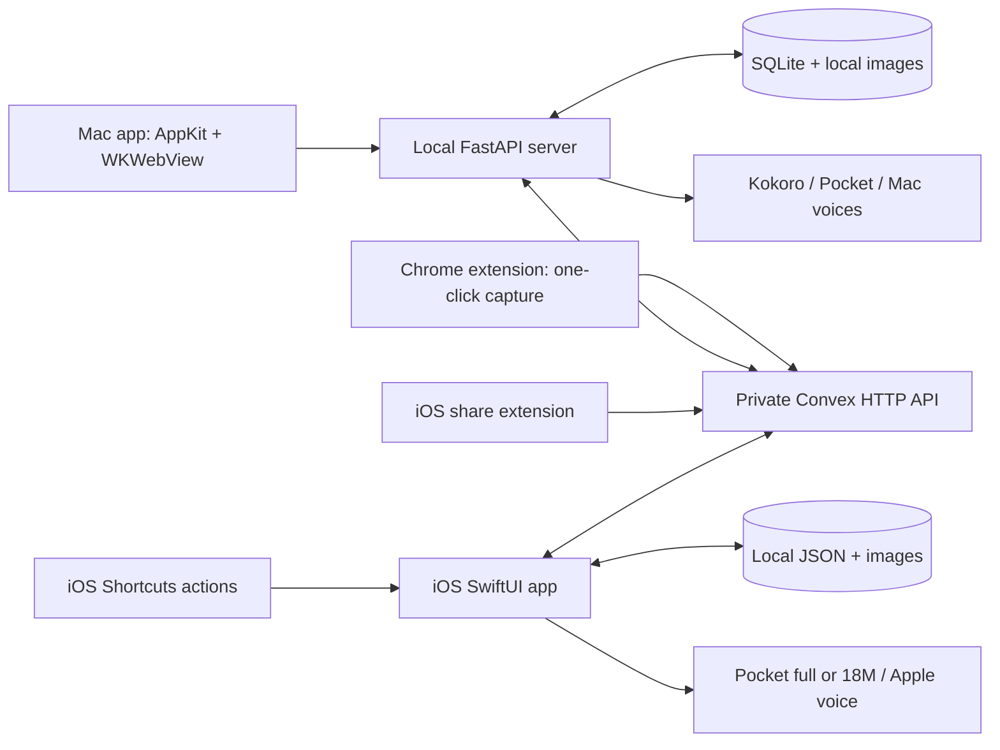

# How Local Reader works

Local Reader has two independent readers and one shared library service. Each reader owns local storage and generates its own speech. Convex moves article data between devices; it does not synthesize audio or require the Mac to stay online for the phone to work.

## Mac runtime

`desktop/main.swift` creates an AppKit window containing a persistent WKWebView. It starts the existing Python server when needed and loads `http://127.0.0.1:8787`. `web/` is compiled by Vite into `dist/`; FastAPI serves those files and the local APIs.

The app bundle embeds the source installation path in `LocalReaderSourcePath`. It does **not** embed Python, source code, or model weights. The Python environment is `~/Library/Caches/local-reader/venv` (installs made before that name keep their earlier path; `LOCAL_READER_PYTHON` overrides both). Pocket uses a separate environment at `~/Library/Caches/local-reader-pocket/venv`. Moving the source checkout requires rebuilding the wrapper or setting `LOCAL_READER_SOURCE`. The bundle also records `LocalReaderUpdateRepository`, the GitHub `owner/name` of the checkout's `origin` at build time; `scripts/update-mac.py` refuses to fetch from any other repository.

Mac document storage is SQLite at `~/Library/Application Support/Local Reader/library.sqlite3`. Imported images and generated audio are local files under the same data directory. The server binds to loopback and checks request host/origin. Quitting the window app leaves the local server running. Chrome imports do not depend on that server. The browser fallback and native window share server data but have separate browser-storage preferences.

Kokoro uses MLX/Apple Metal. Pocket runs in its own CPU worker with installed offline assets. Mac voices use `say`. The server serializes synthesis, caches WAV files and timing metadata, and the UI schedules buffered audio using Web Audio. Model-derived Kokoro timings and approximate Pocket/Mac timings have different precision; a highlighted word is not an assurance of forced alignment.

## iPhone runtime

`ios/` is a SwiftUI app rather than a website running in the background. It persists `library.json`, images, and speech models under its Application Support directory. The sync credential is stored separately in Keychain with after-first-unlock accessibility. Local changes and pending-sync markers are written before network upload.

Pocket uses FluidAudio, pinned by `ios/prepare.sh` to revision `e396cf780c4abf8e395087467c0585d3b0d17f68`. There are two models: **Pocket full** (`PocketTtsManager(language: .english2026Apr, placement: .ane)`, the same English checkpoint as the Mac, converted to Core ML) and the smaller **Pocket 18M** (`PocketTtsSmallManager(model: .english18m, computeUnits: .cpuAndNeuralEngine)`). Details are in [ios/README.md](../ios/README.md#speech). `prepare.sh` checks the SDK out under ignored `ios/.build/` and selects upstream's Swift 6.0 compatibility manifest, because Xcode 26.0 does not propagate the newer SwiftPM TTS traits; the SDK source is unchanged. This is a different runtime from Mac Python Pocket. Initial download and Core ML preparation require the app to stay open; after that, synthesis is local. Apple voice is an explicit fallback.

Playback uses an AVAudioSession playback category, background-audio capability, lock-screen commands, queued synthesis, and interruption/headphone handling. These mechanisms support background playback, but a simulator build cannot establish reliable sustained inference on a locked physical iPhone. Device acceptance testing is still required.

## Shared library and conflict handling

Each user deploys `convex/` to their own Convex project (see [Setup](SETUP.md#sync-backend-optional)). The API implements a **single personal library**, authenticated by a bearer pairing token configured as `SYNC_TOKEN`. It is not a multi-user account/tenant system. The pairing token is distinct from a Convex deployment/admin credential; clients never need an admin key.

Article text, image metadata, and formatting marks live in Convex storage blobs; small document summaries live in the database. Images are authenticated uploads/downloads through the HTTP API. Raw cloud storage URLs are not exposed to the reader. Sync clients refuse redirects that could forward credentials to another host.

Each document has a stable ID and five independent field clocks, expressed as Unix epoch **seconds**:

| Clock | Fields it controls |
| --- | --- |
| `contentUpdated` | Words, paragraphs, images, formatting marks |
| `metadataUpdated` | Title, source URL, tags |
| `updated` | Listening position |
| `readUpdated` | Manual read/unread status |
| `lifecycleUpdated` | Archive/delete state |

Each field family accepts a strictly newer timestamp; ties keep the accepted value. Updating tags or marking a piece read/unread cannot overwrite listening progress. Read status is explicitly chosen, never inferred from the word index. Older clients that omit read status cannot reset it. Replacing text with shorter content clamps the saved word index. This is timestamp-based conflict resolution, not text merging; concurrent edits to the same field family do not retain both versions. Devices should keep their clocks accurate.

Mac sync runs periodically while the server is running and supports **Sync now**. iOS syncs on activation and after queued local changes. Both preserve local data on failure. Articles/images/tags/progress/read status/archive/delete state sync; generated audio, model downloads, and engine preferences do not. Archive is reversible; accepted deletion creates a sticky tombstone for that article ID. Newer/stale full-document uploads cannot resurrect a deleted ID. Storage reclamation and secure erasure are not implemented: historical content blobs, image/audio caches, and backups can remain after library removal.

Lifecycle fields are `archived`, `deleted`, and `lifecycleUpdated`, defaulting to `false`, `false`, and `0` for old documents. Modern clients request `/sync?format=2` to receive tombstone summaries and remove those articles locally without fetching their content. Legacy `/sync` omits deleted entries, and `GET /documents` returns 404 for deleted IDs. An accepted tombstone makes subsequent upserts of that ID a no-op, including uploads from clients that omit lifecycle fields. Restoring an archive does not undo deletion.

The local Mac `sync.json` contains its endpoint and pairing token. Phone pairing uses a private `localreader://pair?...` link, shown as a QR code on the Mac, and asks the user to confirm the hostname before saving the credential. It is an access credential, not a public sharing URL. Cloud sync is authenticated and encrypted in transit; it is **not end-to-end encrypted** against the service operator.

## Chrome → cloud import

The extension is an independent client of the sync backend. It does not need the Mac app, localhost server, or Chrome native-messaging host to be running.

1. Pair the extension with the private library using its settings and a pairing URL from an already paired reader.
2. A user clicks Send to Local Reader. `activeTab` permits capture of the current rendered article or selected text; browser cookies are not collected.
3. The click authorizes immediate import. Capture/upload status persists so the user can check the outcome or retry; no review screen is required.
4. It saves article text to the authenticated Convex HTTP API first. A shared three-slot pool then copies supported images and adds them to the same article with a newer content clock, preserving its original progress and metadata clocks. Receipts are checkpointed serially and images retain their source order, so retries skip already uploaded images.
5. Mac and iPhone clients pick up the new document on their next sync. The Mac can be closed throughout the import.

The extension stores its pairing configuration in `chrome.storage.local` restricted to trusted extension contexts, separate from the Mac's `sync.json` and the iPhone's Keychain. Captured drafts and import jobs live in extension-local IndexedDB. Queued, uploading, failed, or partially imaged jobs are retained until completed or explicitly discarded; the pending-job limit is 20. Only completed jobs and unused legacy drafts are eligible for cleanup after 24 hours. An offscreen extension document performs uploads independently of the popup after an explicit Import or Retry action. Opening the popup only inspects status and never creates/resumes an offscreen upload job. Persistent status and explicit retry keep a closed popup from losing the job. It is a privileged credential for the same single personal library. It must not be bundled into the extension or shared in a screenshot. Chrome's local extension storage is not a substitute for end-to-end encryption.

The extension requests `activeTab`, `scripting`, `storage`, and `offscreen`, plus access to HTTPS Convex sites. The default import uses text and already captured image bytes. Transient image failures can be retried with **Retry images**; pending jobs can also be managed from settings. Clicking **Import this page** (or **Allow remaining images**) also asks Chrome for the optional `http://*/*` and `https://*/*` host permissions, so images can be fetched from their original sites and CDNs. This is an all-sites permission; the extension uses it only to fetch article images after an explicit click, and declining still imports the text and any images readable from the page itself. Loaded same-origin/CORS-readable image pixels are reused without a download. Fallback image requests use `cache: force-cache` with credentials omitted; cross-origin pixel restrictions and cache partitioning mean the page’s cached entry is not always reusable. Image receipts from authenticated `POST /images` are attached with a second `POST /documents` after the text-first save. There is no localhost or native-host requirement.

URL imports within the Mac reader make a bounded server-side public-page request with redirect/address checks. Browser capture is used for content already available through the user's signed-in page; it does not copy that browser authentication to the backend or bypass access controls.

## Semantic formatting without changing playback positions

Articles keep their existing whitespace-tokenized `words` array. `marks` annotate global word ranges using `{start, end, kind, href?}`; `end` is exclusive, and `kind` is `bold`, `italic`, `underline`, or `link`. Only links carry a validated HTTP(S) `href`. Paragraph ranges remain a contiguous partition of the same words, classified as `paragraph`, `heading`, or `blockquote`. Quote blocks appear inset with a vertical rule in both readers.

Python HTML/Markdown import, Chrome capture, and supported iOS page imports preserve these semantic marks. Renderers escape content and apply the supported styles; they do not render arbitrary imported HTML, scripts, or CSS. Overlapping bold/italic ranges can coexist. Since marks do not insert or remove words, existing word indices, audio positions, and highlighting remain stable. Old documents without marks render as before. A plain-text source or edited text may not retain the original annotations.

Formatting schema version 2 adds `blockquote` paragraph kinds. Stored cloud content carries `formatVersion: 2`; upgraded clients request `GET /documents?id=…&format=2` to receive quotes unchanged. Legacy requests receive the same words/marks with quote paragraphs downgraded to ordinary `paragraph` and `formatVersion: 1`. This avoids breaking old renderers while preserving the stored content. The Mac sync client performs a one-time equal-content-clock refresh of old formatting caches without moving reading progress or editing the cloud article's clock.

## iPhone import paths

The iOS Share extension is a separate process/bundle (`<bundle prefix>.localreader.share`). `ios/prepare.sh` generates Safari preprocessing from the reviewed Chrome extractor. Loaded Safari pages provide a passive preprocessing payload with article words, paragraphs, marks, and image references. URL-only input uses a bounded anonymous HTML/text fetch with no cookies/scripts/redirects; selected/plain text is imported directly.

The main app publishes only the paired HTTPS site and library token into its supported shared Keychain group. The share extension can instead hold its own pairing when that group is unavailable. It uploads directly to Convex and maintains a local pending queue for failed/offline uploads; a successful upload is then discovered by the main app's normal sync. Optional image failures do not discard the article text. There is no dependency on Mac runtime or an App Group shared library file.

Shortcuts actions run through the main app and save to its local library: **Save Text to Local Reader** accepts title/text/tags; **Save Web Article to Local Reader** accepts a public URL. Local text saves can work offline, while URL retrieval requires connectivity. These actions then use the same normal sync pipeline.

The share extension's entitlements, Share sheet/Shortcuts behavior, and sustained locked-phone speech depend on a signed installation on a physical device; a simulator build does not exercise them.
